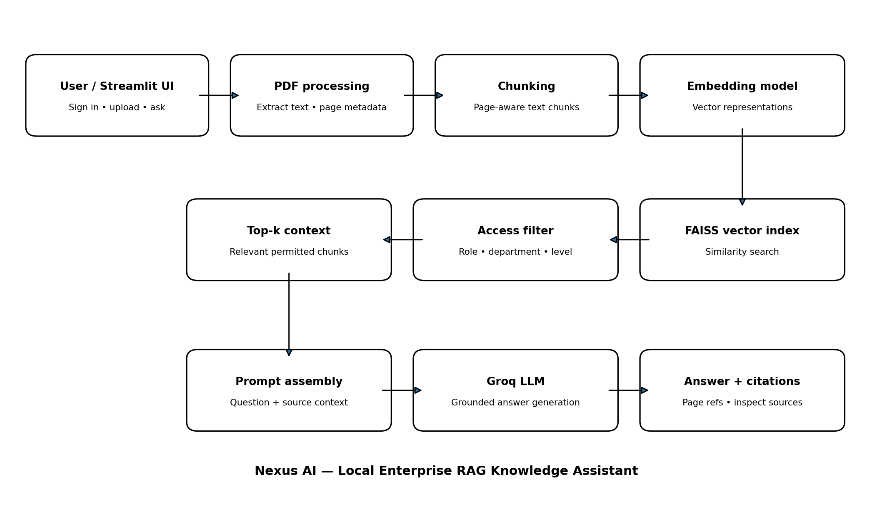

# Nexus AI — Enterprise Knowledge Assistant

Nexus AI is a local, document-grounded question-answering assistant built with Streamlit. Users upload policy PDFs, the application extracts and chunks their content, indexes the chunks for semantic retrieval, and generates answers grounded in retrieved passages with page citations.

> **Project/demo notice:** Nexus AI is an academic/portfolio prototype. The sample Nexus Labs policy documents used during testing are fictional. Do not upload confidential company documents or expose credentials in a public repository.

## Features

- Multi-PDF upload and processing
- PDF text extraction and chunking
- Embedding-based semantic retrieval with FAISS
- LLM answer generation through Groq
- Page-based source citations and retrieved-source inspection
- Document metadata for department and access level
- Role-based access filtering (including Admin access)
- Streamlit user interface

## Architecture



A detailed diagram is available at [`docs/architecture.png`](docs/architecture.png).

## Technology stack

- Python
- Streamlit
- FAISS for vector similarity search
- Sentence-transformer embeddings (confirm the exact model name in your configuration)
- Groq API for answer generation
- PDF extraction/chunking utilities

## Local setup

### 1. Clone the repository

```bash
git clone <YOUR_GITHUB_REPOSITORY_URL>
cd <YOUR_REPOSITORY_FOLDER>
```

### 2. Create and activate a virtual environment

Windows PowerShell:

```powershell
python -m venv .venv
.venv\\Scripts\\Activate.ps1
```

macOS/Linux:

```bash
python -m venv .venv
source .venv/bin/activate
```

### 3. Install dependencies

```bash
pip install -r requirements.txt
```

### 4. Configure environment variables

Create a `.env` file in the project root and add your Groq API key using the variable name expected by your code. For example:

```env
GROQ_API_KEY=replace_with_your_key
```

Do not commit `.env` or API keys. If the project uses a different environment variable name, use the one referenced in your source code.

### 5. Run the application

```bash
streamlit run app.py
```

## How to use

1. Sign in using a configured demo account.
2. Choose the document department and access level in the sidebar.
3. Upload one or more PDF files.
4. Click **Process** to extract, chunk, embed, and index the documents.
5. Ask a question in the chat.
6. Inspect **Retrieved document sources** to review supporting chunks and page citations.

## Access-control behavior

Uploaded document chunks carry metadata such as department and access level. Retrieval applies access filtering before returning context to the language model. The Admin role is configured to access all departments in the current prototype. Non-admin users are limited according to the access rules in the application.

This is a prototype access-control implementation. Review and independently test it before using real confidential information.

## Project structure

The names below describe the major modules discussed during development. Adjust this tree to match the files actually present in your repository.

```text
enterprise-rag-assistant/
├── app.py
├── document_loader.py
├── chunker.py
├── uploaded_document_store.py
├── generator.py
├── requirements.txt
├── .env.example
├── .gitignore
└── docs/
    ├── architecture.png
    └── project_report.pdf
```

## Testing performed

- PDF upload and processing with multiple policy documents
- Direct policy questions and questions requiring information across passages
- Answers for topics absent from the provided documents
- Source/page citation inspection
- Admin-only access test using a synthetic secret
- Finance department document retrieval test
- Access behavior for Admin and department-associated users

Test outcomes should be described accurately based on your latest local runs. The project was tested locally; deployment is not part of the current scope.

## Limitations

- Retrieval quality depends on PDF text extraction, chunking, embedding quality, and relevance ranking.
- Scanned PDFs may require OCR if text extraction does not recover their content.
- Conflicting policies can be retrieved together; the assistant should surface conflicts rather than silently resolve them.
- Answers are limited to the content made available in the retrieved context.
- Authentication and access-control code should not be treated as production-ready without a security review.
- The app is designed for local demonstration, not production deployment.

## Future improvements

- Add OCR support for scanned PDFs
- Add hybrid retrieval (keyword + vector) and reranking
- Improve conflict detection and policy version handling
- Add richer evaluation with a question/answer test set
- Add audit logs and stronger identity management
- Support additional file types if needed

## Security and repository hygiene

Before publishing:
- Keep `.env`, API keys, local vector indexes, uploaded business documents, and user data out of Git.
- Include only synthetic sample documents that you have permission to share.
- Review the repository history for accidentally committed credentials.
- Replace placeholder clone URL and adjust dependency/model details to match the implementation.

## License

Choose and add a license before publishing. If you are unsure whether you want others to reuse the code, do not add a license yet.
